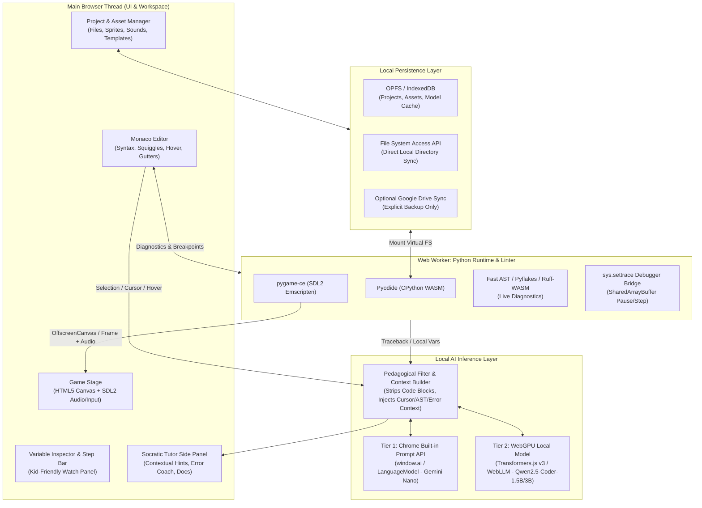

# Pywlet — Architecture & Design Plan

**Pywlet** is a fully offline-capable, browser-based Python and Pygame IDE designed for an 11-year-old learner. It combines a real code editor (**Monaco Editor**), an in-browser Python + Pygame runtime (**Pyodide**), and a local Socratic AI tutor (**Chrome Prompt API / WebLLM / Transformers.js**) engineered strictly to **explain, guide, and teach—never to write code for the student**.

---

## 1. Guiding Principles & Pedagogy

1. **Learn by Doing, Not Copy-Pasting:**
   - The AI tutor acts as a friendly Socratic mentor.
   - **Hard guardrail:** AI responses are post-processed and system-prompted so they never output multi-line copy-pasteable solution code blocks. It may show a 1-line syntax pattern (e.g., how `range(start, stop)` works in general) or use analogies, hints, and questions to help the learner spot their own bug.
   - Editor auto-completion is tuned for **discovery** (showing available methods on `pygame.Surface` or `pygame.Rect` with kid-friendly docstrings), not ghost-text AI code completion.
2. **100% Local & Offline-First:**
   - All assets (Monaco workers, Pyodide WASM + pre-built `pygame-ce` wheels, fonts, icons, starter sprites/sounds, and local LLM weights) are served locally or cached via Service Worker / Origin Private File System (OPFS).
   - Zero cloud dependencies required to code, run games, or ask the tutor.
   - Optional, explicit export/backup plugins (local `.zip` bundle, local folder sync via File System Access API, or optional Google Drive backup when online).
3. **Low Friction, High Visual Feedback:**
   - Instant game canvas preview alongside the code.
   - Kid-friendly error translations alongside real Python tracebacks so the student learns to read real errors without getting intimidated.
   - Built-in asset manager for viewing/previewing sprites (`.png`), sounds (`.wav`/`.ogg`), and tilemaps.

---

## 2. System Architecture



---

## 3. Core Components & Technical Stack

### 3.1 Frontend & Application Shell
- **Framework:** **Vanilla TypeScript + Vite** (zero UI framework overhead, clean DOM components, CSS custom properties) built as an installable Progressive Web App (PWA) and static bundle that runs from a local folder (`npx serve` / Python `http.server` with COOP/COEP headers).
- **Required HTTP Headers (for SharedArrayBuffer & WebGPU):**
  - `Cross-Origin-Opener-Policy: same-origin`
  - `Cross-Origin-Embedder-Policy: require-corp`
  - *(Note: Using `coi-serviceworker` allows these headers to work even when served from a simple static server or `file`/local directory server without custom header config).*

### 3.2 Code Editor (`monaco-editor`)
- **Python Language Support:**
  - Custom Monarch tokenizer + Python configuration for syntax highlighting, indentation guides, and rainbow brackets.
  - **In-Worker Static Analysis & Type Hints:** Run `pyright` / `jedi` (inside Pyodide) or `ruff-wasm` in a lightweight background worker to provide instant red/yellow squiggles (`SyntaxError`, `NameError` for undefined variables, unclosed parentheses, missing colons) within ~100ms of typing.
- **Interactive Learning Affordances:**
  - **"Ask about this" Code Actions & Context Menu:** Right-clicking or clicking the lightbulb on a highlighted expression, keyword, or red squiggle sends that exact AST node + surrounding lines to the Socratic Tutor.
  - **Hover Cards:** Hovering over `pygame.draw.rect` or `for i in range(10):` shows a visual diagram/cheat-sheet card first, with a button: *"Explain how this works in my code"*.
  - **Live Gutter Indicators:** Breakpoint dots (🔴), current executing line arrow (➡️), and friendly error icons (🐞) that open an explanation bubble when clicked.

### 3.3 Python & Pygame Execution Engine (`pyodide` + `pygame-ce`)
- **Why `pygame-ce` on Pyodide:**
  - Pyodide ships with Emscripten SDL2 support and `pygame-ce` (Pygame Community Edition) wheels.
  - **Async Game Loop Adaptation:** Standard desktop Pygame uses a blocking `while running:` loop. In the browser, Emscripten requires yielding to the browser event loop each frame.
  - **Transparent Loop Transformer:** Before running the student's code, Pywlet can run a lightweight Python AST transformer so the student can write **standard textbook Pygame code** (`while running:` + `clock.tick(60)`) without needing to learn `asyncio` first! The AST rewrite automatically yields to the browser loop inside `pygame.display.flip()`, `pygame.display.update()`, or `clock.tick()`.
- **Canvas & I/O:**
  - Renders to a dedicated `#canvas` element in the "Game Stage" pane.
  - Keyboard and mouse events are captured only when the Game Stage is focused (with a clear visual indicator: *"Game Active — Press Esc to return to editor"*).
  - Standard `print()` output streams to a clean Console tab underneath the Game Stage.

### 3.4 Kid-Friendly Debugger & Inspector
- **Mechanism:**
  - Uses `SharedArrayBuffer` + `Atomics.wait()` inside a Python `sys.settrace` hook in the Pyodide Web Worker.
  - When a breakpoint is hit or the student clicks **Pause / Step Over / Step Into**, the worker pauses synchronously and posts the current stack frame and local variables (`x`, `y`, `player_rect`, `score`) to the main thread.
- **Visual Variable Watch:**
  - Displays primitive values (`score = 5`, `is_jumping = True`) and special visual previews for Pygame types (e.g., showing a `pygame.Rect(100, 200, 32, 32)` highlighted directly on top of the paused Game Canvas!).

---

## 4. Local AI Tutor Architecture (No Code Generation)

### 4.1 Pluggable Backend Inference Strategy (`LLMBackend` Interface)
To guarantee offline operation and make swapping models effortless, Pywlet defines a strict `LLMBackend` TypeScript interface (`init()`, `streamChat()`, `abort()`, `getStatus()`). **Transformers.js (WebGPU/WASM)** is the primary default backend, with plug-in adapters for Chrome Prompt API and local HTTP servers:

```typescript
export interface LLMBackend {
  readonly id: string;
  readonly displayName: string;
  init(onProgress?: (progress: { status: string; percent?: number }) => void): Promise<void>;
  streamResponse(messages: ChatMessage[], onToken: (chunk: string) => void, signal?: AbortSignal): Promise<string>;
  dispose(): Promise<void>;
}
```

| Tier | Backend Adapter | Default Model | Pros / Role |
| :--- | :--- | :--- | :--- |
| **Primary (Default)** | **`TransformersJsBackend`** (`@huggingface/transformers` WebGPU / WASM in a dedicated Worker) | `onnx-community/Qwen2.5-Coder-1.5B-Instruct` (or `Qwen2.5-0.5B-Instruct` fast fallback, `q4f16` / `q4`) | Runs in any modern browser via WebGPU (with WASM fallback); weights cached in browser Cache/OPFS or loaded from a local `/models/` folder for 100% offline use. |
| **Plugin 2 (Zero-Download)** | **`ChromePromptBackend`** (`LanguageModel` / `window.ai`) | Gemini Nano (built into Chrome) | Optional instant backend when Chrome's built-in AI flags are enabled. |
| **Plugin 3 (Local Daemon)** | **`OpenAICompatibleBackend`** (`localhost:11434` / `localhost:8080`) | Any local Ollama / `llama.cpp` model | Optional connector if running a larger local model on the host machine. |

### 4.2 Pedagogical Guardrails ("Explain, Never Solve")
Small models love to output full code blocks by default. We enforce non-generation through three layers:

1. **System Prompt Framing:**
   ```text
   You are Pywlet, an encouraging Python & Pygame mentor for an 11-year-old creator.
   STRICT RULES:
   1. NEVER write or rewrite the user's solution code.
   2. NEVER output multi-line code blocks (```python ... ```).
   3. Keep answers short (2 to 4 sentences), warm, and easy to read.
   4. When explaining an error, point out WHAT line or symbol Python got confused by, WHY it happened, and ask a guiding question so the student can type the fix themselves.
   5. You may use tiny inline code examples with generic names (like `my_list[0]`) to explain syntax rules.
   ```
2. **Structured Context Injection:**
   When the student asks a question or clicks a button, Pywlet constructs a focused prompt automatically:
   - **Mode A — Explain Under Cursor / Selection:** Sends the AST node type (e.g., `For` loop, `Attribute` access), the highlighted snippet, and 5 lines of surrounding context.
   - **Mode B — Live Error Coach:** Triggered automatically (or with 1 click) on a syntax/runtime error. Sends the error type, line number, the offending line, and local variable types.
   - **Mode C — Project Coach ("How do I..."):** Sends the project file list and current file outline (functions/variables) so the tutor can guide the student on *where* to add a feature (e.g., *"Look inside your `while running:` loop where you check `pygame.KEYDOWN`..."*) without writing the code.
3. **Output Stream Filter (Hard Gate):**
   - As tokens stream from the local model, if the model starts emitting a fenced code block (```` ``` ````) longer than 2 lines or closely matching the student's file, the stream filter intercepts it and converts or truncates it into a conceptual hint.

### 4.3 Rule-Based Instant Diagnostics (Zero-Latency Pre-LLM Layer)
Before even invoking the LLM, a deterministic Python error translator immediately annotates common beginner mistakes:
- `SyntaxError: expected ':'` → *"Python needs a colon `:` at the end of `if`, `for`, `while`, and `def` lines to know a block is starting."*
- `IndentationError` → *"Check the spaces at the start of this line! Everything inside a block needs to line up."*
- `NameError: name 'screen' is not defined` → *"Python doesn't know what `screen` is yet. Did you spell it differently earlier, or create it after this line?"*
- Pygame-specific checks (detected via AST):
  - Calling `pygame.draw.*` without calling `pygame.display.flip()` or `update()` inside the loop.
  - Drawing *before* `screen.fill(...)` (which erases the drawing every frame!).

---

## 5. Workspace, File System & Offline Packaging

### 5.1 Project Structure
Every project in Pywlet is a self-contained directory stored in **IndexedDB / OPFS** (or directly mapped to a folder on disk via the Chrome **File System Access API** `showDirectoryPicker()`):

```text
my-space-game/
├── pywlet.json          # Project metadata, entry point, window size
├── main.py              # Main game code
├── player.py            # Additional modules (optional)
└── assets/
    ├── sprites/         # .png, .jpg (with built-in pixel preview & dimensions)
    └── sounds/          # .wav, .ogg (with play button & copy-filename helper)
```

### 5.2 Starter Templates & Built-in Asset Pack
To make starting fun and completely offline, Pywlet bundles:
1. **Starter Templates:**
   - *Blank Python Script* (Console mode)
   - *Bouncing Ball* (Minimal Pygame loop)
   - *Sprite Collector* (Keyboard movement + collision detection starter)
2. **Offline CC0 Asset Library:**
   - Pre-bundled sprites (spaceships, characters, tiles, coins) and retro sound effects that can be added to any project with one click, showing the exact path (`"assets/sprites/alien.png"`) to type into `pygame.image.load()`.
3. **Offline Cheat-Sheet Drawer:**
   - Visual reference cards for Python basics (variables, lists, loops, `if/else`) and Pygame essentials (Coordinate system where `(0,0)` is top-left, RGB color picker, key constants like `pygame.K_SPACE`, `Rect` collision diagrams).

### 5.3 Backup & Export Options
- **Local Folder Mode (Primary):** Open/save directly to a folder on the computer (e.g., `~/PywletProjects/space_game`).
- **One-Click `.zip` Export / Import:** Download or drag-and-drop a project archive anywhere.
- **Optional Google Drive Sync:** An opt-in module (loaded only when the user enables it and is online) using Google Drive `appDataFolder` or a designated user folder to back up project `.zip` snapshots.

---

## 6. User Interface Layout

```text
+-----------------------------------------------------------------------------------+
| [🐍 Pywlet]  Project: Space Dodger ▾  | [▶ Run] [⏸ Pause] [⏭ Step] [⏹ Stop]  [💾] |
+----------------+----------------------------------+-------------------------------+
| FILES & ASSETS | main.py                          | 🎮 GAME STAGE (400x300)       |
|                |----------------------------------| +---------------------------+ |
| 📄 main.py     |  1  import pygame                | |                           | |
| 🎨 assets/     |  2                               | |        👾                 | |
|   🖼 ship.png  |  3  pygame.init()                | |                           | |
|      (32x32)   |  4  screen = pygame.display...   | |            🚀             | |
|   🔊 laser.wav |  5                               | +---------------------------+ |
|                |  6  while running:               | 🔍 Variables: x=180, score=3  |
| -------------- |  7      screen.fill((0, 0, 20))  +-------------------------------+
| 📚 CHEATSHEETS |  8      pygame.draw.rect(...) 🔴 | 🤖 PYWLET TUTOR (Offline Ready)|
| • Coordinates  |  9  ⚠️  if x = 10:               | ----------------------------- |
| • Key Names    | 10          score += 1           | 💡 Line 9 has a single `=`!   |
| • Colors (RGB) |                                  | In Python, `=` puts a value   |
| • Loops        | [Explain Selection] [What's 🐞?] | into a box. What symbol do we |
|                |----------------------------------| use to *compare* two things?  |
|                | > Console Output                 |                               |
|                | Hello from pygame-ce!            | [Ask about cursor/project...] |
+----------------+----------------------------------+-------------------------------+
```

---

## 7. Phased Implementation Roadmap

### Phase 1: Offline Foundation & Editor + Runtime
- Scaffold Vite + TypeScript offline PWA with local asset bundling.
- Integrate `monaco-editor` with local workers and Python syntax support.
- Set up the Pyodide Web Worker with bundled offline wheels (`pyodide`, `pygame-ce`).
- Build the HTML5 Canvas bridge and the AST `while running:` async loop transformer so standard Pygame scripts run smoothly at 60 FPS in the browser.

### Phase 2: Project Workspace & Beginner Diagnostics
- Implement the virtual filesystem backed by OPFS/IndexedDB + local directory sync (`showDirectoryPicker`).
- Add the Asset Manager (drag-and-drop sprites/sounds, built-in offline CC0 starter pack, pixel dimension viewer, RGB color picker).
- Implement the AST linter & Pygame common-mistake detector (squiggles in Monaco + instant friendly error explanations).

### Phase 3: Local Socratic AI Tutor
- Implement `TutorService` supporting **Chrome Prompt API** (`LanguageModel`) and **Transformers.js / WebLLM** (`Qwen2.5-Coder-1.5B-Instruct` cached locally).
- Wire editor actions: *"Explain token under cursor"*, *"Explain highlighted code"*, *"Help me with this error"*, and *"Ask about my project"*.
- Implement the pedagogical prompt templates and the streaming code-block guardrail filter.

### Phase 4: Visual Debugger, Cheat-Sheets & Optional Backup
- Add `SharedArrayBuffer`-based step debugging (`Pause`, `Step`, breakpoints in Monaco, live variable watch panel, and visual `pygame.Rect` canvas overlay).
- Add interactive Python & Pygame visual cheat-sheets (coordinate grid explorer, key constant tester).
- Add `.zip` import/export and optional Google Drive backup integration.
